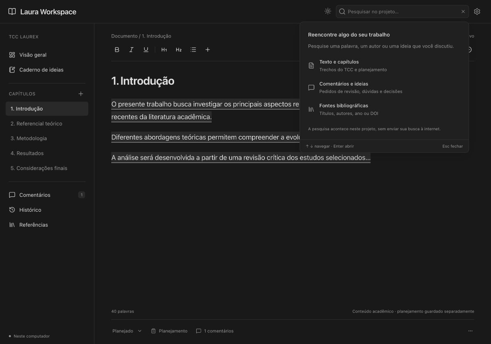

# Laura Workspace

Um ambiente local para organizar e revisar o TCC com o ChatGPT como colaborador de escrita. Sem chat próprio, hospedagem, banco remoto ou API de geração de texto.

## Abrir pela primeira vez

1. Baixe este repositório como ZIP e extraia a pasta, ou clone-o.
2. **Windows:** abra `Configurar-Windows.cmd`. Ele verifica o componente necessário, instala pelo gestor do Windows quando disponível, prepara a aplicação e abre o navegador.
3. **macOS / Linux:** execute `Configurar.command`. É necessário Node.js LTS 24 instalado; se faltar, o script informa como obter a versão oficial.
4. Na tela de boas-vindas, dê um nome ao projeto e crie a estrutura de capítulos ou importe seu arquivo pelas configurações.

Nas próximas vezes, use **`Abrir-Laura.cmd`** no Windows ou **`Abrir-Laura.command`** no macOS/Linux. A aplicação abre em **http://localhost:3000**. Mantenha a janela de inicialização aberta. Para encerrar, use `Ctrl+C` nessa janela. Não é necessário compreender os componentes internos.

**Para enviar à Laura:** o [prompt principal está aqui](docs/SETUP_PROMPT.txt). Ele orienta a instalação única, o início do site, a preparação MCP e a preservação do projeto atual no ChatGPT. Esse prompt fica no repositório; o site oferece somente [um pedido de reparo](docs/MCP_REPAIR_PROMPT.txt), caso a integração pare. Não compartilhe senhas nem chaves em conversas.

## O que você pode fazer

- Criar capítulos, seções e subseções antes de escrever; alterar títulos, ordem e andamento.
- Separar objetivos e planejamento do texto acadêmico, sem exportá-los por acidente.
- Editar texto, títulos, listas, tabelas, equações e figuras locais.
- Selecionar texto para abrir uma barra contextual de formatação e comentários.
- Responder, resolver e reabrir comentários; verificar sua associação ao trecho original.
- Guardar ideias, hipóteses, dúvidas, tarefas, decisões e sugestões da IA em um caderno separado.
- Cadastrar referências reais, importar BibTeX e abrir citações e notas de rodapé no contexto.
- Revisar propostas com comparação antes/depois. Aprovar e aplicar são ações separadas.
- Consultar versões, restaurar conteúdo e recuperar backups sem apagar o histórico existente.
- Usar modo claro, escuro ou conforme o sistema. O app ocupa toda a janela; apenas as áreas de conteúdo rolam.

## Trabalhar com o ChatGPT

A conexão MCP começa **desligada**. O assistente local prepara leitura e escrita com autorização explícita; Configurações → ChatGPT permite consultar e revogar esse acesso. O ChatGPT pode criar capítulos, notas, comentários e propostas. Revisões de texto existente precisam de aprovação local antes de serem aplicadas. Uma edição não resolve um comentário automaticamente.

**Estado comprovado:** o servidor foi testado com clientes reais do SDK MCP, por stdio e HTTP autenticado. **A ligação à conta ChatGPT Pro da Laura exige configuração e uma chamada real nessa conta; não está certificada por esses testes locais.**

O caminho preferido é o Secure MCP Tunnel oficial: conexão de saída, sem abrir uma porta pública. A disponibilidade depende das permissões da conta e do workspace; a assinatura Pro, isoladamente, não prova essas permissões. Veja [docs/MCP.md](docs/MCP.md).

A configuração é assistida uma vez: use [o prompt pronto](docs/SETUP_PROMPT.txt) e salve [o contexto](docs/PROJECT_CONTEXT.txt) no projeto existente do TCC no ChatGPT. A interface não inclui exportações nem troca manual de JSON. Consulte [operação e retomada](docs/OPERATING_MODEL.md).

## Importar o TCC

Abra Configurações:

O documento permite alternar entre Visual, Código LaTeX e Lado a lado. O fonte nativo é versionado localmente; o MCP cria com `latex` e revisa com `afterLatex`, mediante aprovação. A visualização de código usa CodeMirror com realce de sintaxe e linhas numeradas.

- **LaTeX `.tex`:** um subconjunto seguro é convertido para edição visual. Comandos, ambientes ou argumentos não suportados fazem o arquivo permanecer como bloco protegido, sem descartar seu código.
- **Projeto `.zip`:** o arquivo completo é preservado. Escolha o `.tex` principal quando houver ambiguidade. O editor não expande automaticamente `\input`, estilos, macros e dependências.
- **Word `.docx`:** importação de texto com aviso explícito. A fidelidade de formatação, campos, tabelas e imagens permanece no original; não se apresenta isso como conversão acadêmica fiel.
- **BibTeX `.bib`:** entradas são analisadas por parser próprio. Nenhuma fonte ou DOI é inventado.

Os originais podem ser baixados novamente em Configurações. O arquivo de origem nunca é sobrescrito. Para projetos complexos, mantenha o LaTeX original como fonte final de formatação e utilize o workspace para planejamento e revisão. [Limites do LaTeX](docs/LATEX.md).

## Dados, backup e atualização

Em Configurações → Avançado → Alterar pasta dos dados, use **Escolher pasta…** para abrir o seletor nativo do macOS ou Windows. No Linux, o seletor usa Zenity ou KDialog quando disponíveis. Cancelar preserva a seleção anterior; selecionar uma pasta não copia nem muda os dados até a ação separada **Copiar projeto para esta pasta**. A opção de informar um caminho manual continua disponível como alternativa.

Os dados ficam **fora da pasta da aplicação**:

| Sistema | Pasta inicial                                  |
| ------- | ---------------------------------------------- |
| Windows | `%LOCALAPPDATA%\LauraWorkspace`                |
| macOS   | `~/Library/Application Support/LauraWorkspace` |
| Linux   | `~/.local/share/LauraWorkspace`                |

O caminho real aparece em Configurações. É possível copiar o projeto para uma pasta nova e vazia e passar a usá-la após reiniciar. O estado anterior permanece preservado. A alteração desliga a conexão MCP.

Há salvamento automático, rascunho de emergência no navegador e versões transacionais. O servidor local verifica alterações a cada hora: mantém uma cópia por hora nos últimos 7 dias e uma por dia até 30 dias, preservando sempre pelo menos três cópias automáticas existentes. A inicialização e o encerramento normal também tentam proteger as alterações; sem mudanças no projeto, histórico ou originais, nenhuma cópia idêntica é criada. Eventos de auditoria de consultas não geram duplicatas. Dias sem alterações não criam arquivos extras: a última cópia continua preservada.

Cada nova cópia automática passa por restauração em um banco temporário. Antes de qualquer limpeza, todas as cópias catalogadas têm sua integridade conferida e a cópia atual é validada por restauração. Uma falha interrompe a limpeza. Somente arquivos `auto-…json` registrados no índice automático pertencem a essa política; cópias manuais, pontos antes de operações e backups legados permanecem preservados. A antiga opção `backupRetentionDays` é mantida apenas para compatibilidade dos dados; a política automática fixa substitui essa configuração. Consulte [a política e recuperação](docs/RECOVERY.md).

- **Exportar tudo:** baixa um backup com documentos, planejamento, notas, comentários, referências, originais e versões.
- **Histórico:** compara e restaura versões do projeto; restaurar cria uma versão nova.
- **Restaurar backup:** importa um backup, verifica a integridade e preserva o estado atual antes de restaurar.
- Guarde também uma cópia do backup em outro disco. Um backup no mesmo computador não protege contra perda física do equipamento.

Para atualizar, encerre o app, preserve um backup, substitua **apenas a pasta da aplicação** e execute o configurador novamente. Não exclua a pasta de dados. Nunca armazene seu TCC dentro do repositório de código. Veja [recuperação](docs/RECOVERY.md).

## Limites e validação

A aplicação não verifica fontes academicamente nem certifica conformidade ABNT/UFRJ. A compilação visual produz PDF de revisão; o projeto institucional original continua responsável pelo PDF final. Construções não suportadas são preservadas ou bloqueiam a exportação, em vez de serem eliminadas silenciosamente.

O Windows é o alvo prioritário dos scripts. Execução interativa neste desenvolvimento ocorreu no macOS; a matriz de CI verifica o código em Windows e Linux. O resultado de uma execução no PC da Laura continua sendo uma etapa de aceitação separada.

[Arquitetura e desenvolvimento](docs/ARCHITECTURE.md) · [Testes e evidências](docs/VALIDATION.md) · [MCP](docs/MCP.md) · [Recuperação](docs/RECOVERY.md)
