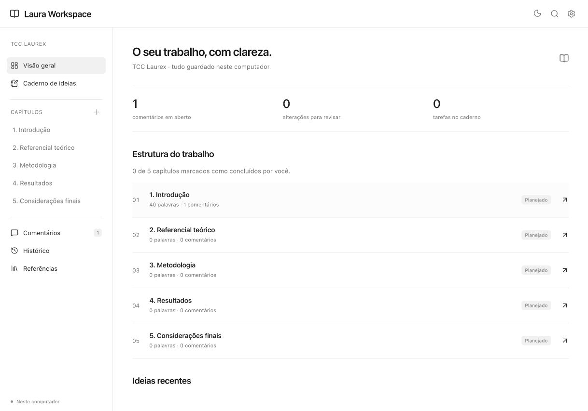
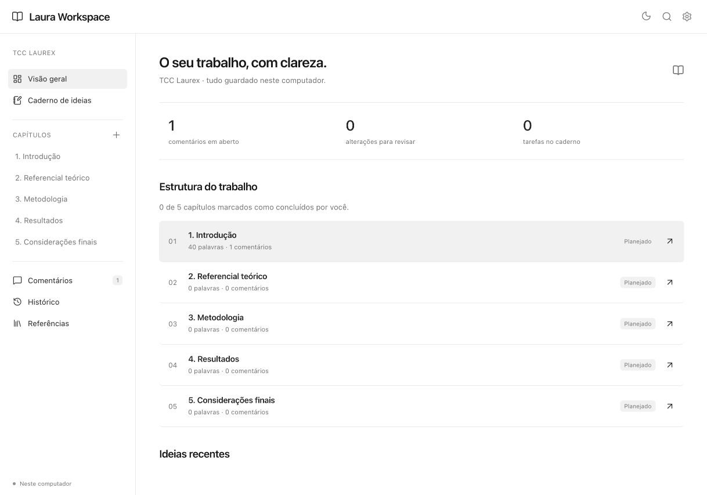
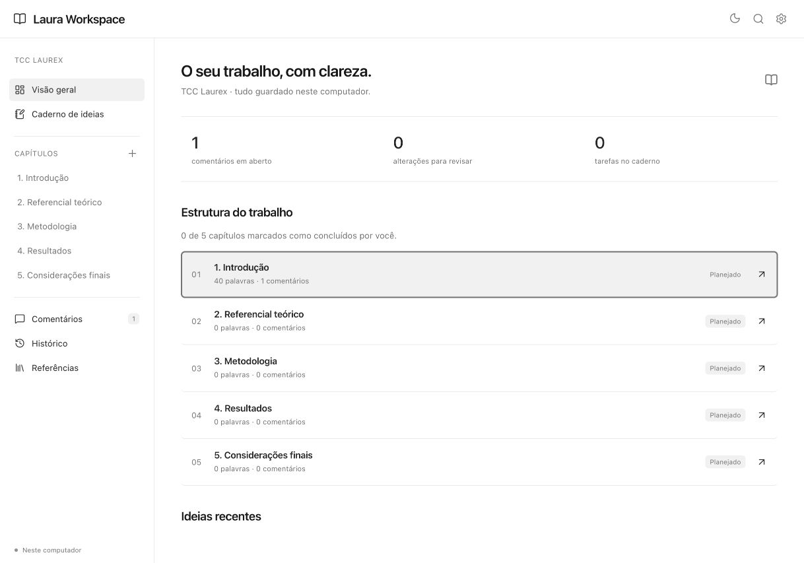
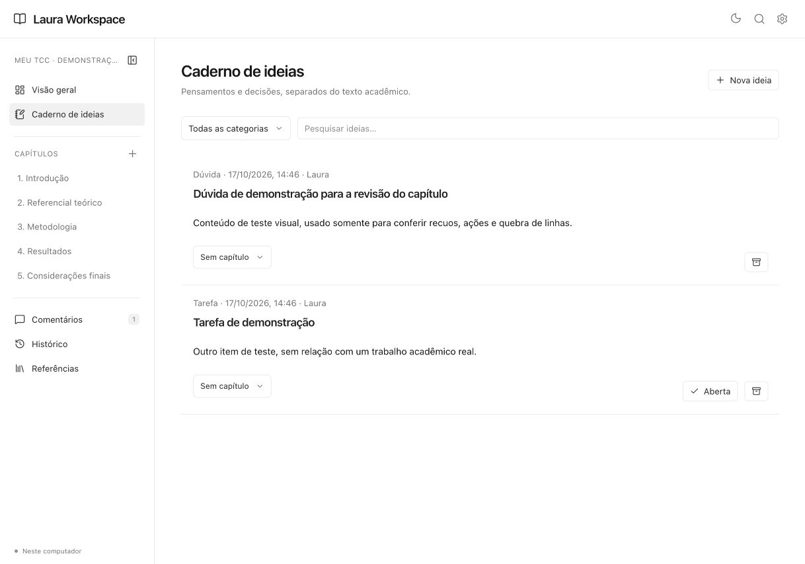
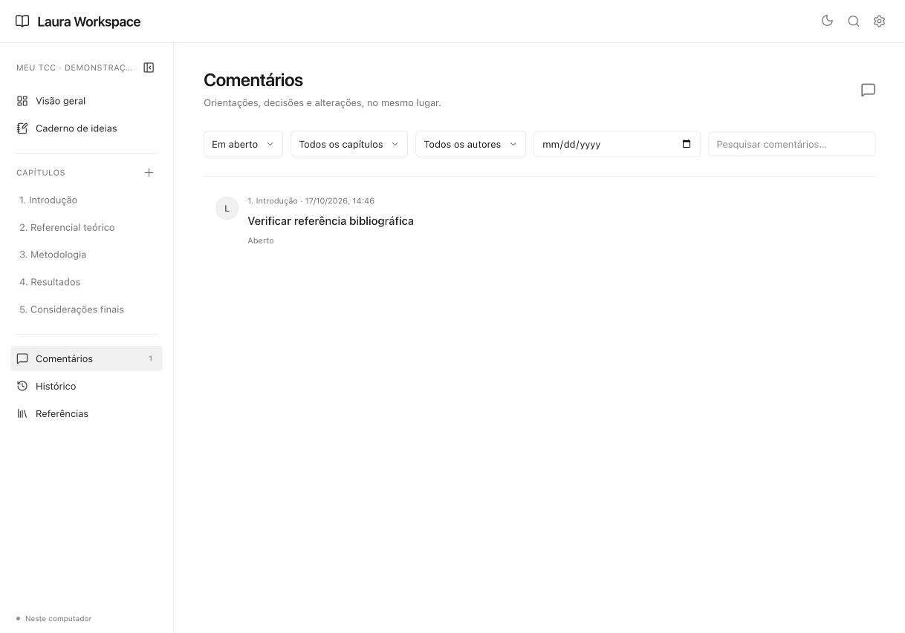
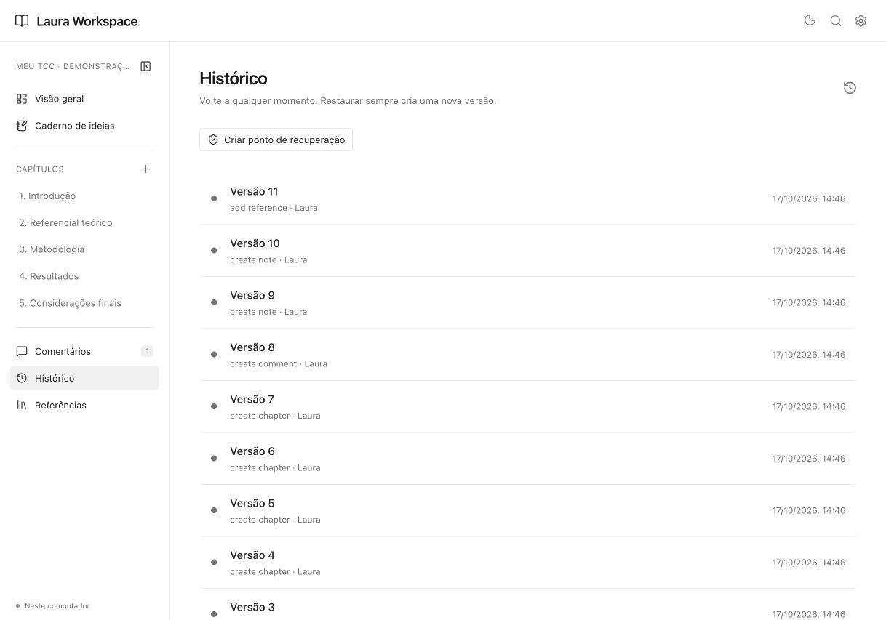
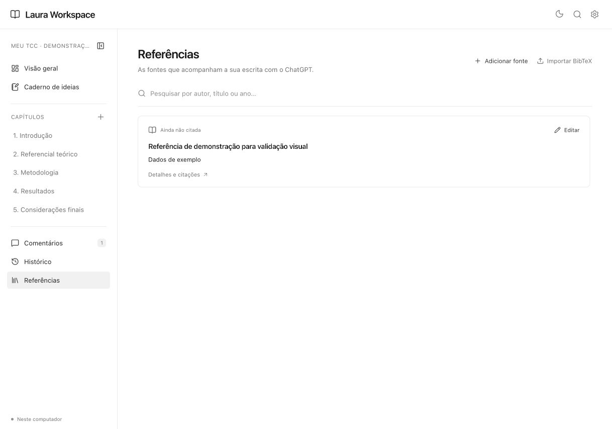
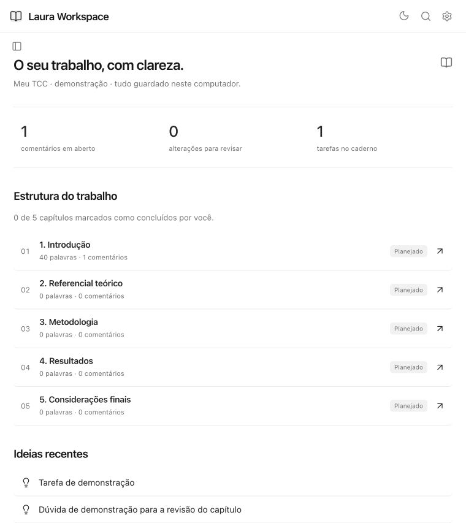
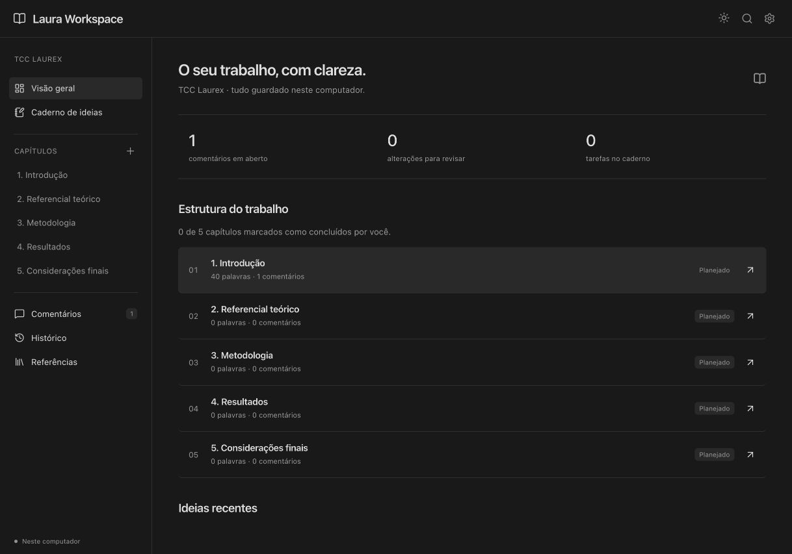

# Validação de espaçamento — Laura Workspace

Auditoria visual e correção realizadas em 17/10/2026. Escopo: superfícies clicáveis de capítulos, métricas, links, ideias, comentários, histórico e referências. Capturas atuais no navegador real; as telas com ideias e referência de exemplo usam dados sintéticos em um ambiente temporário separado. Esses dados não foram inseridos no workspace principal.

## Regra adotada

A referência foi o [sistema de espaçamento oficial Carbon, da IBM](https://www.carbondesignsystem.com/building-blocks/foundations/spacing/overview): uma escala consistente de tokens para o interior dos componentes e para os intervalos entre eles. A [especificação de menus](https://www.carbondesignsystem.com/building-blocks/core/components/menu/specifications) distingue o espaçamento estrutural do feedback de hover/foco. Os valores desta aplicação são decisões locais: 8 px para controles internos, 12 px para recuos compactos e 16 px para linhas e cards de conteúdo. Não se trata de impor o mesmo padding a todos os componentes.

## Etapas e resultados

1. **Visão geral — corrigida.** Capítulos tinham padding horizontal de 0 px. O primeiro número e a seta final tocavam a área de hover. Agora ambos têm 16 px de recuo no desktop. Métricas receberam padding próprio, sem aumentar a tipografia. A altura da linha passou de 73,09 para 71,09 px; a correção não tornou a lista maior.
2. **Estados de interação — validados.** Na linha medida, normal e hover mantiveram x=274, y=380,53, largura=904 e altura=71,09 px. O foco real por teclado manteve padding de 16 px e altura de 71,09 px, com outline sólido visível. Cor e outline não mudam a geometria.
3. **Cards e linhas análogas — revisados.** Ideias: 16 px no card e 8 px no botão do título; comentários: 16 px no item e 8 px no resumo; histórico: 16 px. Referências já tinham 18 px vertical/20 px horizontal e foram preservadas. Os preenchimentos e a quebra de linhas foram inspecionados nas capturas. A mesma política de inset foi aplicada às propostas, sem afirmar que foi exercitado todo o fluxo de propostas nesta auditoria.
4. **Links de ideias recentes — corrigidos.** Uma regra de seta final também atingia ícones iniciais, empurrando o conteúdo para a direita. A seta final agora tem classe explícita e o texto está em um elemento próprio. No compacto, o ícone inicia a 12 px da borda.
5. **Largura compacta e tema escuro — validados.** Em 760×853, capítulos e links têm 12 px de padding e o documento raiz não apresenta overflow horizontal. O viewport foi restaurado depois da verificação. No modo escuro, o capítulo manteve padding de 16 px e altura de 71,09 px. O tema anterior foi restaurado.

## Capturas

### 1. Antes

### 2. Depois, sob hover

### 3. Foco pelo teclado

### 4. Ideias e comentários

### 5. Histórico e fontes

### 6. Compacto e escuro

## Validação técnica e limites

Build aprovado, 19 testes locais aprovados e prova MCP local aprovada após as mudanças. Nenhum teste de implementação que apenas espelhasse o CSS foi acrescentado: os recuos foram medidos no DOM real, com screenshots, hover real e foco por teclado. O ambiente temporário foi encerrado e removido; as fontes e capturas necessárias para reproduzir e revisar o resultado foram preservadas.

Isso não é uma certificação de acessibilidade completa: não foram auditados todos os conteúdos possíveis, contrastes, leitores de tela ou todos os níveis de zoom. Não se afirma que todos os estados de todos os componentes foram exercitados. A CI anterior encontrou uma falha na limpeza do diretório temporário do teste de runtime no Windows; a limpeza agora usa a remoção assíncrona com retries para liberação de handles, e a confirmação remota é acompanhada separadamente. Instalação e uso reais no PC de Laura permanecem uma evidência distinta.
